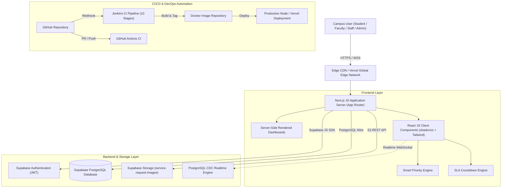
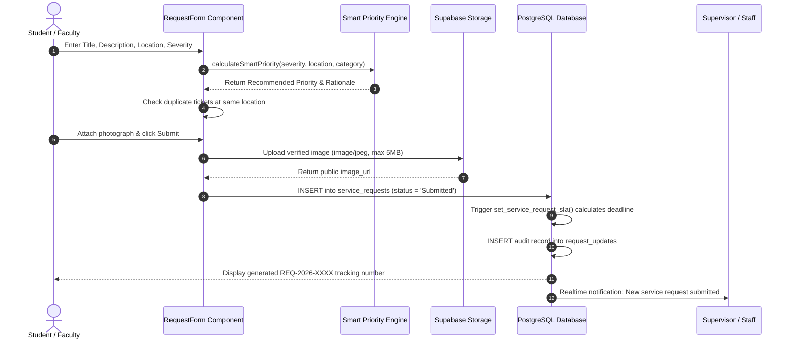
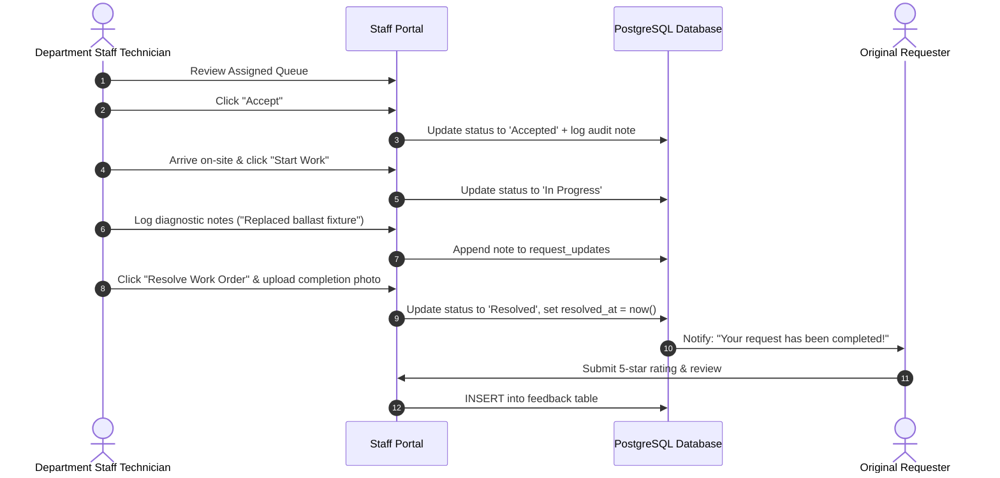

# System Architecture Documentation

## Project Title
**Development of an Integrated Smart Campus and Service Request Management Platform with Automated Testing and Deployment**

---

## 1. High-Level Architecture Overview

The Smart Campus Platform is built on a modern, decoupled cloud architecture designed for high availability, sub-100ms response latencies, and granular role-based security.

---

## 2. Component Design & System Layers

### 2.1 Frontend Presentation Layer
- **Framework:** Next.js 16 with App Router.
- **Rendering Strategy:** Static site generation for marketing and auth routes; Server-Side Rendering (SSR) and Client Components with dynamic hydration for role dashboards.
- **Component System:** shadcn/ui primitives styled with Tailwind CSS, utilizing Radix UI accessible foundations and Lucide React icons.
- **Design Tokens:**
  - Deep Navy: `#101828` (Primary background, header contrast)
  - Teal: `#0D9488` (Brand accents, active CTAs)
  - Background: `#F5F7FA` (Neutral canvas)
  - Status Indicators: Emerald (Resolved), Amber (In Progress), Rose (Critical/Overdue), Blue (Assigned).

### 2.2 Backend & Data Access Layer
- **Client & Server Isolation:**
  - `src/lib/supabase/client.ts`: Browser-safe client using public anon credentials.
  - `src/lib/supabase/server.ts`: Server-side client accessing cookies and user sessions securely.
- **Data Access Services:** Clean abstraction layer (`src/lib/services/`):
  - `requests.ts`: Request CRUD, status progression, assignment dispatch, audit updates.
  - `profiles.ts`: User retrieval, approval queue processing, role management.
  - `departments.ts`: Workload metrics, department and category management.
  - `notifications.ts`: Notification dispatch and read state toggles.
  - `priority-engine.ts`: Multi-factor urgency calculation.
  - `sla.ts`: SLA deadline computation, remaining time calculations, and escalation.
  - `qr.ts`: Location QR code generation and decoding.
  - `storage.ts`: Client-side MIME validation and file uploads.

### 2.3 Database Layer (PostgreSQL)
- **11 Normalized Tables:**
  - `profiles`: User credentials, university IDs, roles, approval statuses.
  - `departments`: Campus operational teams (Facilities, IT, Lab Safety, Grounds, etc.).
  - `service_categories`: Issue types, default priorities, target SLA hours.
  - `locations`: Campus buildings, floors, rooms, and QR code tokens.
  - `service_requests`: Central ticket table with tracking numbers, status, and SLA timestamps.
  - `request_assignments`: Staff technician dispatches.
  - `request_updates`: Immutable audit logs of status transitions and field notes.
  - `feedback`: Recipient ratings (1-5 stars) and qualitative feedback.
  - `announcements`: Official university broadcasts and scheduled maintenance alerts.
  - `notifications`: User inbox notifications.
  - `escalation_history`: Log of overdue tickets escalated to department supervisors.

---

## 3. Data Flow Workflows

### 3.1 Service Request Submission & Smart Priority Flow

### 3.2 Field Technician Work Order Resolution Flow

---

## 4. Security Architecture

1. **Defense in Depth:**
   - Client requests are authenticated via Supabase JWT tokens stored in HTTP-only secure cookies.
   - Every database query passes through PostgreSQL Row-Level Security (RLS) rules verifying `auth.uid()` and user roles.
2. **Zero Credential Exposure:**
   - Secret keys (`SUPABASE_SERVICE_ROLE_KEY`) are never imported or referenced in client-side code bundles.
   - All environment variables are validated via TypeScript definitions.
3. **HTTP Header Hardening:**
   - Configured via `vercel.json`:
     - `X-Content-Type-Options: nosniff`
     - `X-Frame-Options: DENY`
     - `X-XSS-Protection: 1; mode=block`
     - `Referrer-Policy: strict-origin-when-cross-origin`
