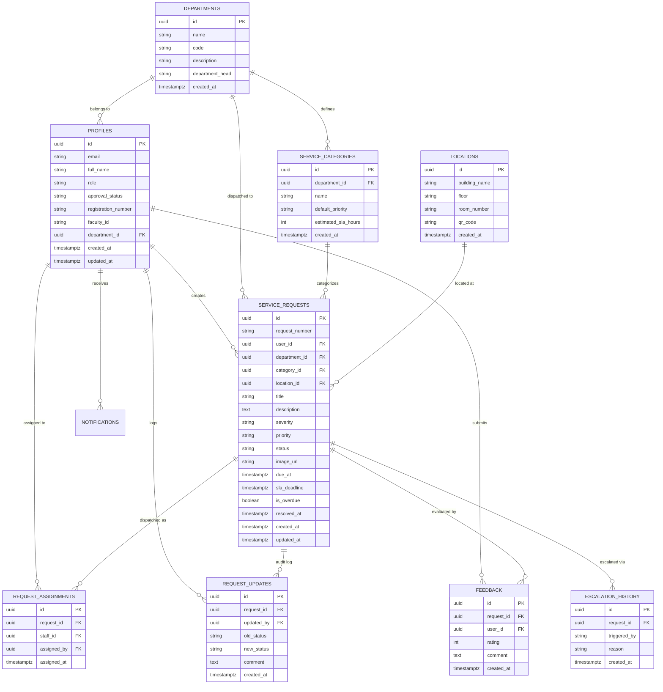

# Database Design & Schema Documentation

## Database Engine: Supabase PostgreSQL 15+

---

## 1. Entity-Relationship Diagram (ERD)

---

## 2. Table Data Dictionary

### 2.1 `profiles`
Stores user profile information linked to `auth.users`.
- `id` (UUID, PK): References `auth.users.id` with CASCADE.
- `full_name` (TEXT, NOT NULL): User's legal name.
- `email` (TEXT, NOT NULL, UNIQUE): Institutional university email.
- `role` (TEXT, NOT NULL): One of `student`, `faculty`, `administrator`, `department_staff`.
- `approval_status` (TEXT, NOT NULL): One of `pending`, `approved`, `rejected`. Default: `pending`.
- `registration_number` (TEXT, NULLABLE): Student university roll or registration ID.
- `faculty_id` (TEXT, NULLABLE): Faculty institutional badge number.
- `department_id` (UUID, NULLABLE): References `departments(id)`.
- `avatar_url` (TEXT, NULLABLE): Public avatar image URL.
- `created_at` (TIMESTAMPTZ, NOT NULL): Timestamp of registration.
- `updated_at` (TIMESTAMPTZ, NOT NULL): Last profile update.

### 2.2 `departments`
Campus operating entities managing service categories and staff.
- `id` (UUID, PK): Primary key identifier.
- `name` (TEXT, NOT NULL): Department name (e.g. Facilities Management, IT Helpdesk).
- `description` (TEXT, NULLABLE): Operating scope.
- `department_head` (TEXT, NULLABLE): Name of department director.
- `created_at` (TIMESTAMPTZ, NOT NULL): Creation timestamp.

### 2.3 `service_categories`
Specific classifications of campus infrastructure issues.
- `id` (UUID, PK): Primary key.
- `department_id` (UUID, NOT NULL): References `departments(id)`.
- `name` (TEXT, NOT NULL): Category title (e.g. Electrical & Power, HVAC).
- `description` (TEXT, NULLABLE): Issue guidance.
- `default_priority` (TEXT, NOT NULL): Default classification (`Critical`, `High`, `Medium`, `Low`).
- `estimated_sla_hours` (INTEGER, NOT NULL): Target resolution SLA in hours (4, 12, 24, 48).
- `created_at` (TIMESTAMPTZ, NOT NULL): Timestamp.

### 2.4 `locations`
Campus physical locations with room tags and QR codes.
- `id` (UUID, PK): Primary key.
- `building_name` (TEXT, NOT NULL): Campus building name.
- `floor` (TEXT, NULLABLE): Floor level.
- `room_number` (TEXT, NULLABLE): Classroom, lab, or office designation.
- `qr_code` (TEXT, NULLABLE): Unique QR token for physical plaque scanning.
- `created_at` (TIMESTAMPTZ, NOT NULL): Timestamp.

### 2.5 `service_requests`
Primary ticket records storing lifecycle state and SLA timestamps.
- `id` (UUID, PK): Unique record identifier.
- `request_number` (TEXT, NOT NULL, UNIQUE): Unique human-readable code (`REQ-2026-XXXX`).
- `user_id` (UUID, NOT NULL): References `profiles(id)`.
- `department_id` (UUID, NOT NULL): References `departments(id)`.
- `category_id` (UUID, NOT NULL): References `service_categories(id)`.
- `location_id` (UUID, NOT NULL): References `locations(id)`.
- `title` (TEXT, NOT NULL): Concise issue summary.
- `description` (TEXT, NOT NULL): Detailed problem narrative.
- `severity` (TEXT, NOT NULL): User-reported severity (`Critical`, `High`, `Medium`, `Low`).
- `priority` (TEXT, NOT NULL): Active dispatch priority.
- `suggested_priority` (TEXT, NULLABLE): Smart Priority Engine recommendation.
- `status` (TEXT, NOT NULL): Current state (`Submitted`, `Under Review`, `Assigned`, `Accepted`, `In Progress`, `On Hold`, `Resolved`, `Closed`, `Rejected`).
- `image_url` (TEXT, NULLABLE): Public URL of initial issue photograph.
- `sla_deadline` (TIMESTAMPTZ, NULLABLE): Calculated target resolution deadline.
- `is_overdue` (BOOLEAN, NOT NULL): Overdue flag set automatically by SLA engine.
- `resolved_at` (TIMESTAMPTZ, NULLABLE): Completion timestamp.
- `created_at` (TIMESTAMPTZ, NOT NULL): Submission timestamp.
- `updated_at` (TIMESTAMPTZ, NOT NULL): Last modification timestamp.

---

## 3. Row-Level Security (RLS) Policy Matrix

| Table | Student | Faculty | Staff | Administrator |
|---|---|---|---|---|
| `profiles` | Read own, Update own name/avatar | Read own, Update own name/avatar | Read all, Update own | Full CRUD on all |
| `departments` | Read all | Read all | Read all | Full CRUD |
| `service_categories` | Read all | Read all | Read all | Full CRUD |
| `locations` | Read all | Read all | Read all | Full CRUD |
| `service_requests` | Insert own, Read own, Cancel own | Insert own, Read own, Cancel own | Read assigned/dept, Update status | Full CRUD on all |
| `request_updates` | Read own tickets | Read own tickets | Insert notes on assigned | Full CRUD on all |
| `feedback` | Insert own, Read own | Insert own, Read own | Read dept ratings | Full CRUD on all |
| `escalation_history` | None | None | Read dept escalations | Full CRUD on all |
